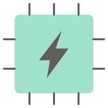

<div align="center">



# Power Intent Studio

[](LICENSE)
[](https://www.python.org/downloads/)
[](#installation)

</div>

Power Intent Studio is a desktop tool for **authoring, visualizing and exporting low-power
intent**. It elaborates your RTL — Verilog, SystemVerilog or VHDL, plus `.lib` black-box macros
— draws the real design hierarchy, and lets you build power intent on top of it interactively:
power domains, supply sets, switches, isolation, retention, level shifters and a power state
table. It reads existing UPF and maps it onto the hierarchy, and it writes UPF 3.0/3.1
and CPF 2.0/2.1 back out. It is aimed at RTL and low-power designers who would rather see a
power architecture than hand-edit a Tcl file and hope.

---

## Features

**Design**
- Elaborates Verilog, SystemVerilog and VHDL, including mixed-language hierarchies, via
  [slang](https://github.com/MikePopoloski/slang) and GHDL
- SystemVerilog interfaces and modports, and `for` / `if` / `case` generate blocks, named
  exactly as EDA tools name them (`u_mem/g_bank[1].u_bank/u_wrap/g_1024x32.u_macro`)
- `.lib` (Liberty) black-box macros, including PG pins and their voltages
- RTL filelist (`.f`) loading — `+define+`, `+incdir+`, nested `-f`, with cycle detection
- Preprocessor defines from a filelist or typed directly, combined at elaboration
- Interactive hierarchy diagram: drill-down tabs, zoom, pan, multi-select, hide/unhide
- Port list and sequential-element tables, with filtering and sorting
- "Inspect Source File" with syntax highlighting for Verilog/SV/VHDL and Liberty

**Power intent authoring**
- Power domains, with colour derived live from the primary supply set
- Supply ports, internal supplies and virtual supplies, with per-supply power states
- Supply sets (power / ground / n-well / p-well), shareable across hierarchies
- Power switches, with control and acknowledge pairs and on/off state expressions
- Isolation and level-shifter strategies, with per-element control
- Retention strategies, with element selection across a multi-hierarchy domain
- Power State Table, with a "Check Power Intent" consistency pass
- Attach an existing UPF/CPF file to a specific macro instance
- Full undo/redo across every edit, shared across open diagram tabs

**Import, export and projects**
- **Load Power Intent** — read an existing UPF file and map it onto the elaborated
  hierarchy, reporting anything that does not resolve or is not modelled, and any command or
  option it does not recognise, with its UPF line
- **Extract Power Intent** — generate **UPF 3.0 / 3.1** or **CPF 2.0 / 2.1**
- **Extract Diagram** — export open diagram views to PNG, JPEG or SVG
- **Save / Load Project** — the whole session in a single `.pis` file

---

## Screenshots

The bundled **`examples/aura_top`** SoC: six power domains, three power switches,
isolation, retention, level shifters, SRAM macros and a seven-state power state table, all
on a SystemVerilog design built from interfaces and generate blocks. The design and its
power intent are described in [`docs/example_aura_top.md`](docs/example_aura_top.md).

<div align="center">

</div>

The top-level power diagram. Domains are coloured by their primary supply, with supply
ports, switches and strategy badges placed on the hierarchy:

<div align="center">

</div>

<table>
<tr>
<td width="50%"><b>Drill-down</b>: <code>u_mem</code>, four generate-built banks, each with a
<code>.lib</code> SRAM macro wired to its supplies<br>
</td>
<td width="50%"><b>Power View</b>: the design listed by power domain<br>
</td>
</tr>
</table>

The Power State Table, one row per system mode:

<div align="center">

</div>

---

## Status

The current release is **1.1.0**. Generated UPF and CPF are checked against the IEEE 1801
and Si2 CPF specifications, against hand-authored reference files, and by round-tripping
through this project's own elaborators. See [CHANGELOG.md](CHANGELOG.md).

---

## Installation

**Requires Python 3.10 or newer.** Verified on Python 3.13.

### End users

Download a ready-to-run build from the
[Releases page](https://github.com/mikespyke17/power-intent-studio/releases).

### From source

```bash
git clone https://github.com/mikespyke17/power-intent-studio.git
cd power-intent-studio
pip install -r requirements.txt
python power_intent_studio.py
```

VHDL support additionally needs [GHDL](https://github.com/ghdl/ghdl) with the
`ghdl-yosys-plugin` on your `PATH`. Verilog/SystemVerilog and `.lib` need nothing beyond the
pip install above.

---

## Quickstart

Everything below uses the bundled **`examples/aura_top`** design, described in
[`docs/example_aura_top.md`](docs/example_aura_top.md).

### The fastest look: open the finished project

```bash
python power_intent_studio.py
```

`File > Load Project` → `examples/aura_top/aura_top.pis`. That is the project in the
screenshots above, with its domains, switches, isolation, retention, level shifters and
power state table already built. Use it to explore before building your own.

### Building it yourself

**1. Create a project**: `File > Create Project`, give it a name.

**2. Load the design** on the *Load Design* tab:

- `Load Filelist (.f)...` → `examples/aura_top/filelist.f`. This loads all 29 sources, in
  order, with the `+incdir+` they need.
- `Load LIB Files...` → `examples/aura_top/lib/lib/aura_sram_tt_0p80v_25c.lib`
- press **Add** to move them to *Loaded*
- set **Top Module** to `aura_top`, press **Elaborate**, then **Continue**

Without a filelist, use `Load RTL Files...` instead. If your design needs preprocessor
defines, type them in the **DEFINE:** field as a comma-separated list (`CPU, CORE=16`).
They are combined with any `+define+` from a filelist.

**3. Choose your starting point.** On *Load Power Intent*, either:

- add `examples/aura_top/upf/aura_top.modern.upf` and press **Mapping** to read the
  existing power intent and draw it on the hierarchy, or
- press **Create New** to start from an empty diagram.

Either way, press **Continue** to reach the *Power Intent* tab.

A smaller starter design, `examples/sram` (one sub-block and one SRAM macro), is bundled too.

---

## Building power intent

The *Power Intent* tab is where the work happens. The vertical **tool palette** down the left
of the diagram selects what a click does; the **right-click menu** on any block offers the
same actions. Every edit is undoable with `Ctrl+Z`.

### Supplies

Pick the **Supply Port** tool, then click the top-level block to add a boundary supply
(`VDD`, `VSS`). Inside the dialog you can also give the supply its **power states** — the
voltages it can be at, and whether it can be off. Those states are what the Power State Table
later selects between.

Two related tools:

- **Internal Supply** — a net that exists only inside the chip, with no boundary port. Its
  states are *inherited*: trace them back through the connectivity to the real source.
- **Virtual Supply** — for driving a macro's internal PG pins, where there is no real net to
  connect.

Use the **Supply Net** tool to wire one supply to another: press on the small handle at a
supply's connection point and drag to the target handle.

### Power domains

Select a block in the diagram (`Ctrl+click` to select several — one domain can span them), then
right-click → **Create Power Domain**.

A domain needs a **Primary Supply Set**: a named grouping of a power rail and a ground rail
(plus optional n-well / p-well). Create one inline from the dialog if you have not already —
pick the supplies you placed in the previous step. The domain's colour is derived from its
primary supply set, so related domains read as related on the diagram.

Add **Secondary Supply Sets** for supplies the domain can also see — a retention or always-on
rail, for instance.

### Power switch

Select the **Power Switch** tool and click a supply icon — the switch attaches to that supply
and drives it. In the dialog:

- **Cell Type** — the library cell name, e.g. a header cell
- **Input / Output / Control / Ack Port** — the switch's own port names
- **Control Signal** — the real RTL signal that drives it, e.g. `pwr_switch_en`
- **On State / Off State** — boolean expressions over that signal

Then draw a **Supply Net** from the switch's top anchor to the supply feeding it.

### Isolation and level shifters

**Isolation Cell** and **Level Shifter** tools work the same way: click a block that belongs to
a power domain. Each dialog asks for the domain, the supply that powers the inserted cells,
and what the rule covers. **Applies To All** chooses either a whole direction of the
domain's boundary (**Inputs**, **Outputs** or **Both**) or **Elements**, an explicit list of
ports picked from a table with a filter and a Direction column. The list includes every
signal reaching the block through a SystemVerilog interface (`bus.rdata`, `ch[0].pwr_en`).

Isolation additionally takes a **clamp value** (low / high / hold), an **Isolation Signal**
and **Sense**, and optional **Source / Sink Supply Sets**. A level shifter takes a **rule**
(low-to-high, high-to-low) and a **location**.

### Retention

The **Retention** tool applies to a block inside a power domain. The dialog asks for the
**Primary** and **Retention** supply sets, the **Save** and **Restore Signals**, and the
sequential **Elements** to retain — the element list is populated from the flops the elaborator
actually found, so you are picking from real registers rather than typing paths.

### Power State Table

The *Power State Table* tab defines the system's power modes. Press **Add State**, name the row
(`ON`, `IDLE`, `RETENTION`, `OFF`), pick the power domain it is scoped to, then choose each
supply net's state from its dropdown — the choices are the power states you gave each supply.

Press **Check Power Intent** to validate: it flags empty cells, duplicate state names and
duplicate state configurations, and reports them in the Diagnostic panel below the table.

### Generate UPF / CPF

`Extract > Extract Power Intent > UPF > 3.1` (or `CPF > 2.0`), pick a path, and the file is
written. For UPF you are also asked which power-state representation to use — the modern
**Power State Group** or the **legacy Power State Table**.

The output for the example is bundled, one file per power-state representation, so you can
see what to expect before generating your own:

- [`examples/aura_top/upf/aura_top.modern.upf`](examples/aura_top/upf/aura_top.modern.upf)
- [`examples/aura_top/upf/aura_top.legacy.upf`](examples/aura_top/upf/aura_top.legacy.upf)

Every construct is written at the top scope, with each domain's hierarchy given by its
`-elements`:

```tcl
create_power_domain PD_CPU \
    -elements { \
        u_cpu \
    } \
    -supply {primary SS_CPU} \
    -available_supplies { SS_CPU_AON SS_CPU_RET }

create_power_switch PSW_CPU \
    -domain PD_CPU \
    -input_supply_port {vin VDD_TOP} \
    -output_supply_port {vout VDD_CPU} \
    -control_port {sleep_n pwr_en_w[2]} \
    -ack_port {ack pwr_ack_w[2]} \
    -on_state {on vin {sleep_n}} \
    -off_state {off {!sleep_n}}
```

`Extract > Extract Diagram` exports the diagram itself to PNG, JPEG or SVG, and
`File > Save Project` stores the whole session in a `.pis` file.

---

## Running Tests

The full regression suite ships with the project.

```bash
pip install -r requirements-dev.txt
pytest
```

Around 2,500 tests covering the RTL and power-intent elaborators, the mapping and validation
layers, every GUI surface, and round-trip fidelity of the generated UPF and CPF. The GUI tests
run headless; on Linux without a display, prefix with `QT_QPA_PLATFORM=offscreen`.

---

## Documentation

| Document | What it covers |
| --- | --- |
| [`docs/example_aura_top.md`](docs/example_aura_top.md) | The `aura_top` example: the design, its power intent, and a tour of the app |
| [`docs/product_workflow.md`](docs/product_workflow.md) | The end-to-end user flow this tool is built around |
| [`docs/architecture.md`](docs/architecture.md) | How the back end and front end are separated, and why |
| [`docs/milestone1_rtl_elaborator.md`](docs/milestone1_rtl_elaborator.md) | RTL elaboration: Verilog/SV, VHDL, `.lib`, connectivity |
| [`docs/milestone2_powerintent_elaborator.md`](docs/milestone2_powerintent_elaborator.md) | UPF and CPF parsing, and the version handling |
| [`docs/milestone3_mapping.md`](docs/milestone3_mapping.md) | Mapping power intent onto the RTL hierarchy |
| [`docs/load_power_intent_mapping.md`](docs/load_power_intent_mapping.md) | Importing an existing UPF/CPF into the diagram |
| [`docs/backend_integration.md`](docs/backend_integration.md) | How the app wires the real back end |
| [`docs/cpf2_reverification_audit.html`](docs/cpf2_reverification_audit.html) | CPF generation audited against the Si2 specification |

---

## Reporting Bugs

Please open an issue using the
[bug report template](.github/ISSUE_TEMPLATE/bug_report.md) — it asks for the steps, the
expected and actual behaviour, and your OS/Python/app version, which is usually everything
needed to reproduce.

Feature ideas are welcome too, via the
[feature request template](.github/ISSUE_TEMPLATE/feature_request.md).

If a real EDA tool rejected or warned about UPF/CPF this app generated, please use the
[UPF/CPF validation feedback template](.github/ISSUE_TEMPLATE/upf_cpf_validation.md)
instead. Those reports are tracked separately under the `vendor-validation` label, because
what makes them actionable is different: the tool's own verbatim message and the snippet that
provoked it, rather than a description of what the GUI did.

Maintainers: a few repository settings are not git-versioned, including that label — see
[`.github/REPO_SETUP.md`](.github/REPO_SETUP.md).

---

## Contact

Michele Chilla — michele.chilla.92@gmail.com

---

## License

Apache License 2.0 — see [LICENSE](LICENSE).

Copyright 2026 Michele Chilla.

Power Intent Studio depends on [liberty-parser](https://pypi.org/project/liberty-parser/),
which is GPL-3.0-or-later, and optionally on GHDL (GPL-2.0-or-later) for VHDL. Consider what
that means for your own distribution before redistributing a bundled build.
