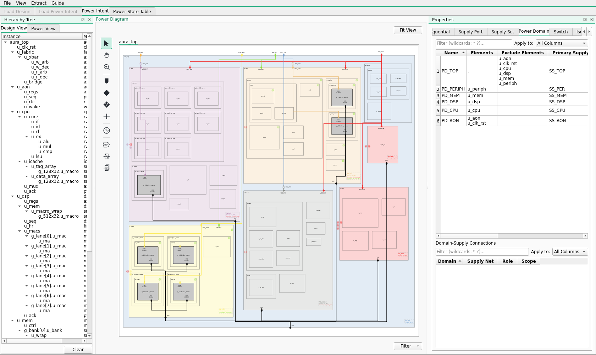
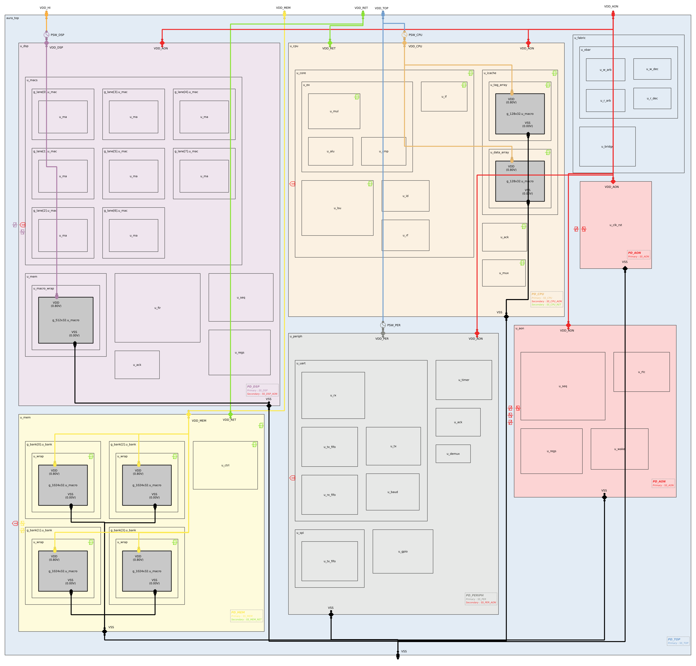
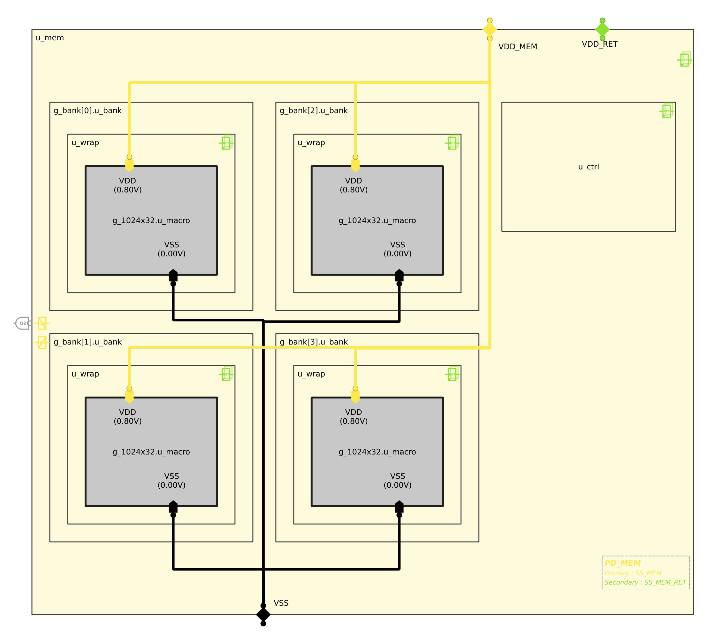
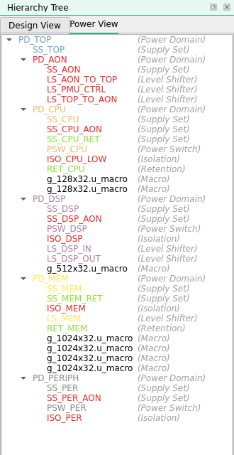
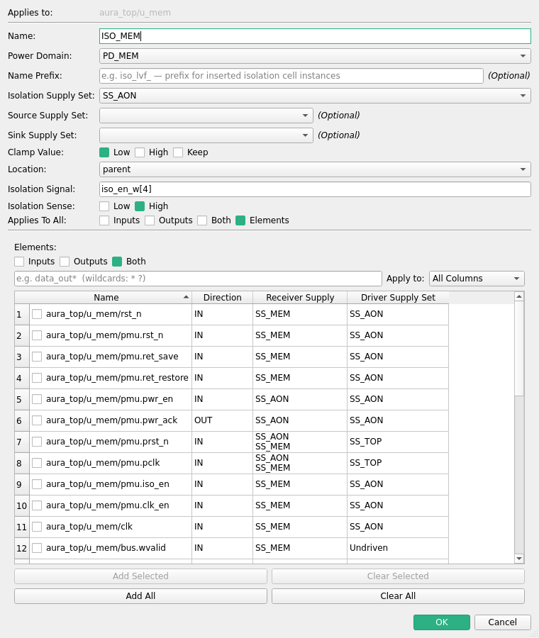
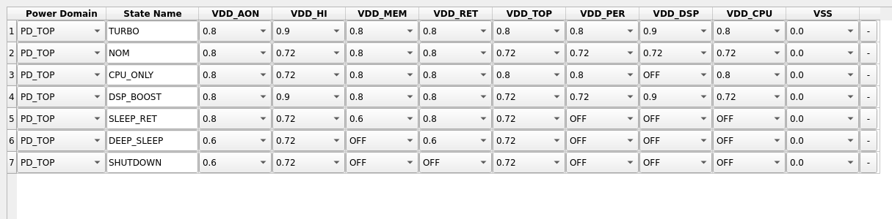

# Example design: `aura_top`

`examples/aura_top` is the reference design for Power Intent Studio. It is a small but
realistic SystemVerilog SoC with six power domains, three power switches, isolation,
retention, level shifters, SRAM macros and a seven-state power state table. Every feature
the app offers is used somewhere in it.

This page describes the design, the power intent built on it, and how both look in the app.
To open the finished project, run `File > Load Project` and pick
`examples/aura_top/aura_top.pis`.

<div align="center">

</div>

---

## The design

**AURA** is an edge-sensor SoC: a RISC-V-style CPU, a DSP block that filters sensor samples,
a banked SRAM, low-speed peripherals and an always-on power management unit (PMU). Every
clock is a gated copy of one root clock (`clk_ref`).

| Instance | Block | Contents |
| --- | --- | --- |
| `u_fabric` | AXI-Lite fabric | crossbar (`u_xbar`) and AXI-to-APB bridge |
| `u_clk_rst` | clock/reset generator | one gated clock and reset per domain |
| `u_aon` | always-on subsystem | PMU sequencer (`u_seq`), registers, RTC, wake logic |
| `u_cpu` | CPU subsystem | core (`u_core`), instruction cache with two `128x32` SRAM macros |
| `u_dsp` | DSP subsystem | 8-lane MAC array (`g_lane[*]`), FIR filter, `512x32` dual-port SRAM |
| `u_mem` | memory subsystem | controller and 4 banks (`g_bank[*]`), each a `1024x32` SRAM macro |
| `u_periph` | peripherals | UART, SPI, timer, GPIO behind an APB demux |

The design uses several SystemVerilog features the app supports:

- **Interfaces with modports** connect almost every subsystem: `axi_lite_if`, `apb_if`,
  `sram_if` and `pmu_if`, including arrayed interface ports such as `u_aon`'s `ch[0]`…`ch[5]`.
  Interface signals appear wherever the app lists a block's I/O, for example
  `u_mem/bus.rdata`.
- **Generate blocks**: `for` loops (`g_bank[0..3]`, `g_lane[0..7]`) and `if` blocks that
  pick the SRAM macro by size. The macro inside `u_mem/g_bank[1].u_bank/u_wrap` is therefore
  named `g_1024x32.u_macro`, the same path a UPF and every EDA tool use.
- **`.lib` black-box macros**: three SRAM sizes, described in
  `lib/lib/aura_sram_*.lib`, including their `VDD`/`VSS` PG pins and voltages.

### Files

| Path | What it is |
| --- | --- |
| `filelist.f` | compile order: packages, interfaces, macros, subsystems, top |
| `pkg/`, `intf/`, `rtl/` | SystemVerilog sources |
| `lib/lib/*.lib` | SRAM Liberty models (TT / SS / FF corners) |
| `lib/db/*.db` | the same libraries in compiled `.db` form |
| `upf/aura_top.modern.upf` | generated UPF 3.1, power states as supply-set states and a power state group |
| `upf/aura_top.legacy.upf` | generated UPF 3.1, power states as port states and a legacy PST |
| `aura_top.pis` | the finished Power Intent Studio project |

---

## The power intent

### Supplies

The chip has six supply ports. Three more supplies are switched copies of them, made
inside the chip by power switches.

| Supply | Kind | States | Feeds |
| --- | --- | --- | --- |
| `VDD_TOP` | port | `HV` 0.80 V, `LV` 0.72 V | fabric, and the CPU and peripheral switches |
| `VDD_AON` | port | `HV` 0.80 V, `LV` 0.60 V | always-on logic, isolation cells |
| `VDD_HI` | port | `BOOST` 0.90 V, `NOM` 0.72 V, `OFF` | the DSP switch |
| `VDD_MEM` | port | `ON` 0.80 V, `RET` 0.60 V, `OFF` | memory subsystem and its SRAMs |
| `VDD_RET` | port | `HV` 0.80 V, `LV` 0.60 V, `OFF` | retention registers in CPU and memory |
| `VSS` | port | 0.0 V | ground for everything |
| `VDD_CPU` | switched, from `VDD_TOP` by `PSW_CPU` | `HV`, `LV`, `SWITCH_OFF` | CPU and its cache SRAMs |
| `VDD_DSP` | switched, from `VDD_HI` by `PSW_DSP` | `BOOST`, `NOM`, `OFF` | DSP and its SRAM |
| `VDD_PER` | switched, from `VDD_TOP` by `PSW_PER` | `HV`, `LV`, `SWITCH_OFF` | peripherals |

A switched supply inherits its source's states and adds one OFF state for the switch, unless
the source can already be off. That is why `VDD_DSP` reuses `VDD_HI`'s `OFF`, while
`VDD_CPU` and `VDD_PER` get `SWITCH_OFF`.

### Power domains

| Domain | Elements | Primary supply set | Also uses | Behaviour |
| --- | --- | --- | --- | --- |
| `PD_TOP` | the top level (everything not listed below) | `SS_TOP` (`VDD_TOP`) | | always on |
| `PD_AON` | `u_aon`, `u_clk_rst` | `SS_AON` (`VDD_AON`) | | always on, voltage-scaled |
| `PD_CPU` | `u_cpu` | `SS_CPU` (`VDD_CPU`) | `SS_CPU_AON`, `SS_CPU_RET` | switched, with retention |
| `PD_DSP` | `u_dsp` | `SS_DSP` (`VDD_DSP`) | `SS_DSP_AON` | switched, voltage-boosted |
| `PD_MEM` | `u_mem` | `SS_MEM` (`VDD_MEM`) | `SS_MEM_RET` | retention voltage or off |
| `PD_PERIPH` | `u_periph` | `SS_PER` (`VDD_PER`) | `SS_PER_AON` | switched |

Each domain also has a supply set on an always-on or retention rail (the "Also uses"
column). Its isolation cells and retention registers run from that set while the domain
itself is off.

### Power sequencing

The PMU (`u_aon/u_seq`) has one `pmu_if` channel per domain, indexed TOP=0, AON=1, CPU=2,
DSP=3, MEM=4, PERIPH=5. Each channel carries `pwr_en`/`pwr_ack`, `iso_en`, `ret_save`/
`ret_restore`, `clk_en` and `rst_n`. The UPF strategies are written against these
signals. The PMU always follows the canonical order:

- **power down**: clock off → retention save → isolation on → switch off
- **power up**: switch on → retention restore → isolation off → reset release → clock on

### Strategies

| Kind | Name | Domain | What it does |
| --- | --- | --- | --- |
| Power switch | `PSW_CPU` | `PD_CPU` | `VDD_TOP` → `VDD_CPU`, control `pwr_en_w[2]`, acknowledge `pwr_ack_w[2]` |
| Power switch | `PSW_DSP` | `PD_DSP` | `VDD_HI` → `VDD_DSP`, control `pwr_en_w[3]` |
| Power switch | `PSW_PER` | `PD_PERIPH` | `VDD_TOP` → `VDD_PER`, control `pwr_en_w[5]` |
| Isolation | `ISO_CPU_LOW` | `PD_CPU` | clamps every output low, from `SS_CPU_AON`, while `iso_en_w[2]` is high |
| Isolation | `ISO_DSP` | `PD_DSP` | clamps every output low, from `SS_DSP_AON` |
| Isolation | `ISO_PER` | `PD_PERIPH` | clamps every output low, from `SS_PER_AON` |
| Isolation | `ISO_MEM` | `PD_MEM` | clamps the AXI response signals of `u_mem/bus` (an interface), placed in the parent |
| Retention | `RET_CPU` | `PD_CPU` | keeps the core, cache and bus-mux registers on `SS_CPU_RET` |
| Retention | `RET_MEM` | `PD_MEM` | keeps the memory controller and bank state on `SS_MEM_RET` |
| Level shifter | `LS_TOP_TO_AON`, `LS_AON_TO_TOP` | `PD_AON` | inputs and outputs of the always-on domain, which can run at 0.60 V |
| Level shifter | `LS_PMU_CTRL` | `PD_AON` | the PMU control signals on every `ch[*]` interface port |
| Level shifter | `LS_DSP_IN`, `LS_DSP_OUT` | `PD_DSP` | in and out of the DSP, which can run boosted at 0.90 V |
| Level shifter | `LS_MEM` | `PD_MEM` | both directions of the memory, which can sit at its 0.60 V retention level |

### System power states

Seven system modes make up the power state table. Each row picks one state for every supply.

| Mode | `VDD_TOP` | `VDD_AON` | `VDD_HI` | `VDD_MEM` | `VDD_RET` | CPU | DSP | PERIPH |
| --- | --- | --- | --- | --- | --- | --- | --- | --- |
| `TURBO` | HV | HV | BOOST | ON | HV | HV | BOOST | HV |
| `NOM` | LV | HV | NOM | ON | HV | LV | NOM | LV |
| `CPU_ONLY` | HV | HV | NOM | ON | HV | HV | off | HV |
| `DSP_BOOST` | LV | HV | BOOST | ON | HV | LV | BOOST | LV |
| `SLEEP_RET` | LV | HV | NOM | RET | HV | off | off | off |
| `DEEP_SLEEP` | LV | LV | NOM | off | LV | off | off | off |
| `SHUTDOWN` | LV | LV | NOM | off | off | off | off | off |

In `SLEEP_RET` the CPU, DSP and peripherals are switched off and the memory drops to its
retention voltage, while the retention registers keep their contents on `VDD_RET`. In
`SHUTDOWN` only the always-on domain and the fabric stay up.

---

## How it looks in the app

### The top-level diagram

Each power domain is a coloured region. Its colour comes from its primary supply set, and
nested domains are carved out of their parent. Supply ports sit on the block edges, power
switches on the supplies they drive, and isolation, level shifter and retention badges on
the blocks they apply to. The info box in each domain's corner names its supply sets.

<div align="center">

</div>

### Drilling into a hierarchy

Double-click any block to open it in its own tab. Here is `u_mem`: four banks made by a
`for` generate, each holding a `1024x32` SRAM macro chosen by an `if` generate
(`g_1024x32.u_macro`). Each macro's `VDD` pin is wired to `VDD_MEM` and its `VSS` pin to
`VSS`, and the green `RET` badges mark the registers kept by `RET_MEM`.

<div align="center">

</div>

### The Power View

The Hierarchy Tree's **Power View** tab lists the design by power domain instead of by RTL
hierarchy: each domain's supply sets, switch, isolation, level shifters, retention and
macros. Right-click any entry to edit or remove it.

<div align="center">

</div>

### Strategies, with interface signals

The isolation dialog for `ISO_MEM` lists every I/O of `u_mem`, including the signals that
reach it through interfaces (`pmu.ret_save`, `bus.wvalid`, ...). Each row shows its
direction and the supply sets driving and receiving it, so it's clear which crossings need
isolating. "Applies To All" chooses between a direction (Inputs, Outputs, Both) and an
explicit element list.

<div align="center">

</div>

### The Power State Table

The seven system modes, one dropdown per supply. The choices in each dropdown are the
states defined on that supply. **Check Power Intent** flags empty cells, duplicate names and
duplicate rows.

<div align="center">

</div>

---

## The generated UPF

`Extract > Extract Power Intent > UPF > 3.1` produces the two bundled files. They differ
only in how they express the power states, which you choose at export time:

- [`upf/aura_top.modern.upf`](../examples/aura_top/upf/aura_top.modern.upf) uses
  supply-set power states (`add_power_state -supply`) and one power state group for the
  system modes.
- [`upf/aura_top.legacy.upf`](../examples/aura_top/upf/aura_top.legacy.upf) uses port states
  (`add_port_state`) and a legacy power state table (`create_pst` / `add_pst_state`).

Everything is written at the top scope, with each domain's hierarchy given by its
`-elements` paths.

```tcl
create_power_domain PD_CPU \
    -elements { \
        u_cpu \
    } \
    -supply {primary SS_CPU} \
    -available_supplies { SS_CPU_AON SS_CPU_RET }

create_power_switch PSW_CPU \
    -domain PD_CPU \
    -input_supply_port {vin VDD_TOP} \
    -output_supply_port {vout VDD_CPU} \
    -control_port {sleep_n pwr_en_w[2]} \
    -ack_port {ack pwr_ack_w[2]} \
    -on_state {on vin {sleep_n}} \
    -off_state {off {!sleep_n}}

set_isolation ISO_CPU_LOW -domain PD_CPU \
  -isolation_supply_set SS_CPU_AON \
  -clamp_value 0 \
  -isolation_signal {iso_en_w[2]} \
  -isolation_sense high \
  -applies_to outputs \
  -location self

connect_supply_net VDD_MEM  -ports {u_mem/g_bank[1].u_bank/u_wrap/g_1024x32.u_macro/VDD}
```

The modern file can be read back with **Load Power Intent**, giving the same domains,
supplies, switches, strategies and power state table. The legacy file is export-only: the app
does not read `add_port_state` back yet.
